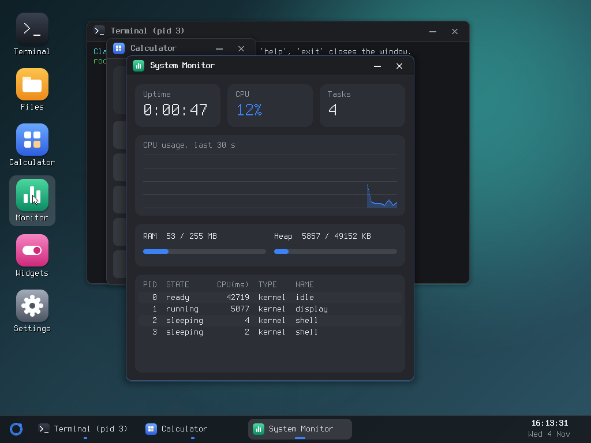
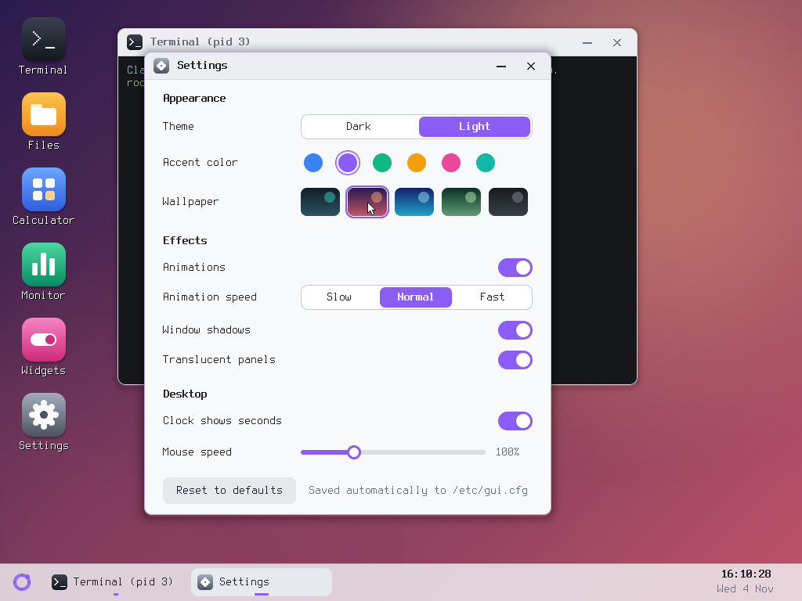
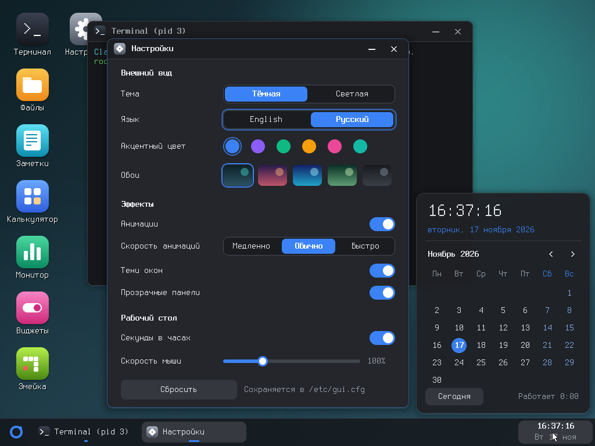
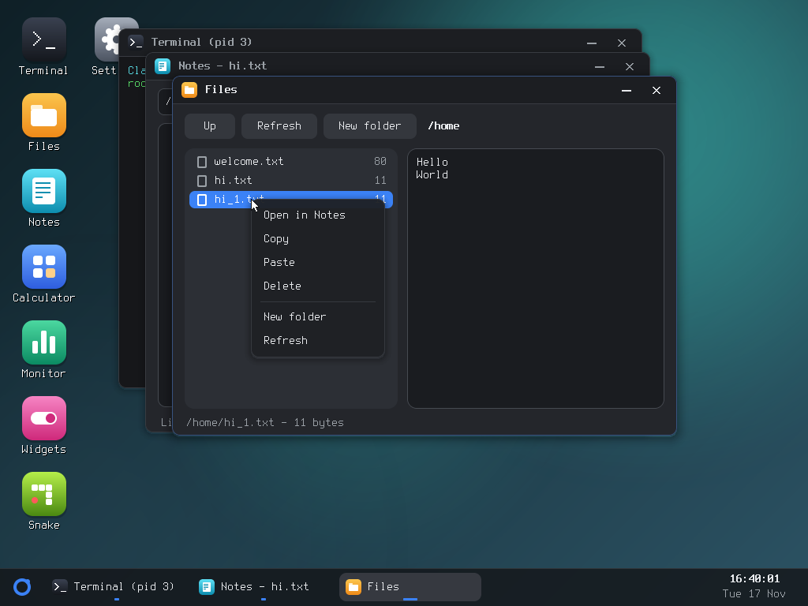
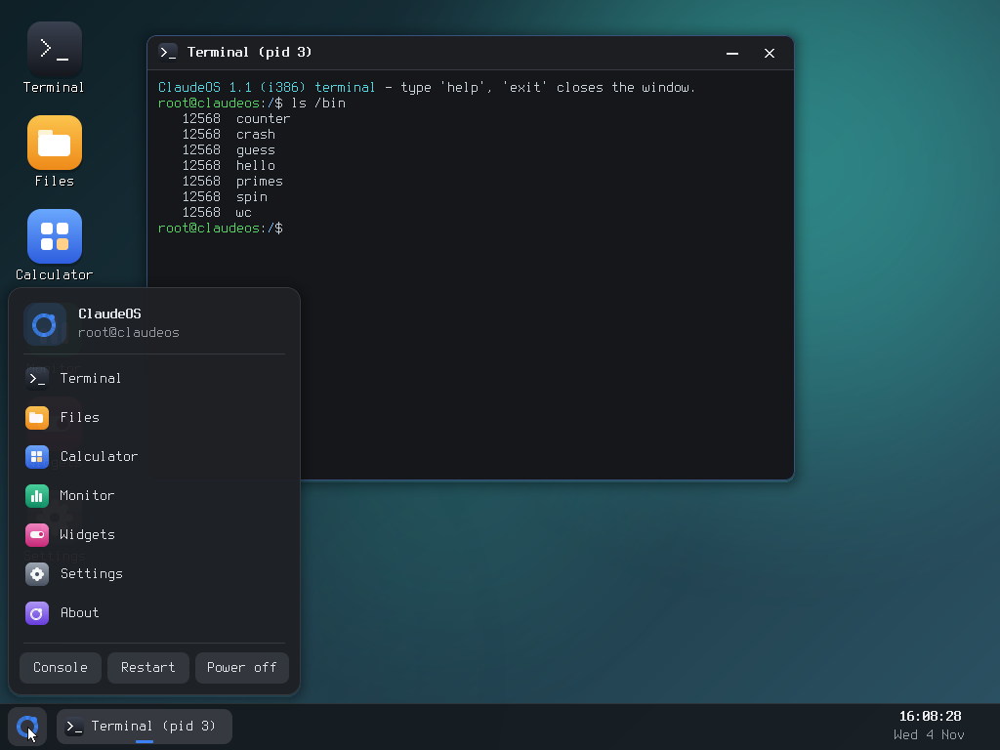
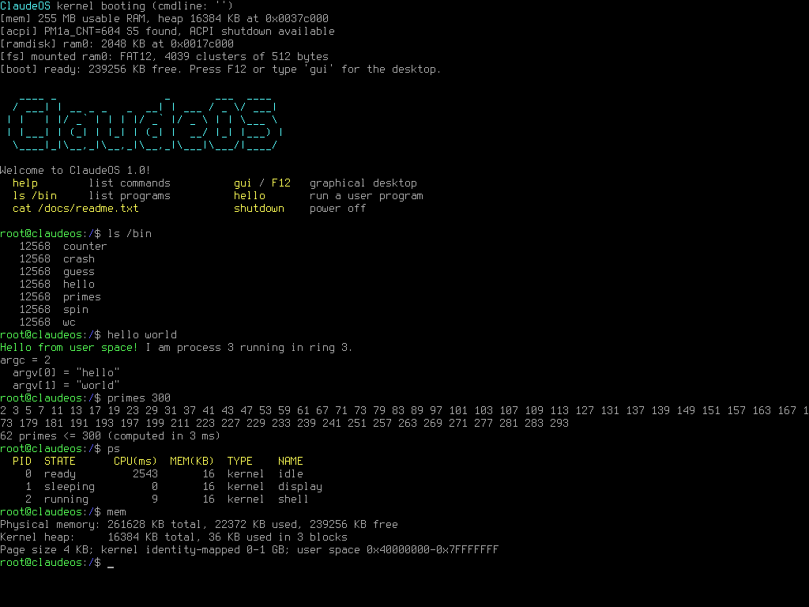

# ClaudeOS

Небольшая, но полностью рабочая операционная система для x86 (i386), написанная с нуля на **C и NASM**.
Загружается из ISO-образа через GRUB, показывает командную строку и графический рабочий стол с
окнами, мышью и виджетами, запускает пользовательские программы в ring 3 и умеет читать и писать
файлы в FAT12/FAT16.

| Рабочий стол (тёмная тема) | Настройки (светлая тема) |
|---|---|
|  |  |
| **Русский интерфейс и календарь из часов** | **Файлы: контекстное меню, копирование файлов** |
|  |  |
| **Меню запуска** | **CLI (полноэкранная консоль)** |
|  |  |

---

## Содержание

1. [Возможности](#возможности)
2. [Архитектура](#архитектура)
3. [Структура исходников](#структура-исходников)
4. [Сборка ISO](#сборка-iso)
5. [Запуск в виртуальной машине](#запуск-в-виртуальной-машине)
6. [Команды и горячие клавиши](#команды-и-горячие-клавиши)
7. [Как добавить свою программу](#как-добавить-свою-программу)
8. [Как расширять ядро: команды шелла и GUI-приложения](#как-расширять-ядро)
9. [Ограничения](#ограничения)

---

## Возможности

| Требование | Реализация |
|---|---|
| Ядро на C/ASM | ~8 000 строк C + NASM, 32-битный защищённый режим |
| Загрузчик | GRUB 2 по протоколу Multiboot 1 (ядро + модуль initrd), три пункта меню |
| Память | битовая карта физических страниц, страничная адресация (4 МБ страницы для ядра, 4 КБ для программ), куча ядра (first-fit) |
| Прерывания | GDT + TSS, IDT, PIC 8259, обработка исключений (ошибка программы убивает только её) |
| Драйверы | PS/2 клавиатура и мышь, таймер PIT (1 кГц), VGA text mode **и** VESA framebuffer, ATA PIO диск, RAM-диск, RTC, COM1, ACPI (выключение) |
| Многозадачность | вытесняющий планировщик round-robin, задачи ядра и процессы ring 3, своё адресное пространство у каждого процесса |
| Файловая система | FAT12 и FAT16: чтение, запись, дозапись, создание/удаление файлов и каталогов |
| CLI | 31 встроенная команда (`help ls cd cat echo mkdir rm clear reboot shutdown ps mem` и др.), история, цвета, Ctrl+C, фоновые задачи `&` |
| Пользовательские программы | ELF32, системные вызовы через `int 0x80`, мини-libc; 7 примеров |
| GUI | современный плоский интерфейс: окна со скруглёнными сглаженными углами и мягкими тенями, композитинг с прозрачностью, градиентные обои, полупрозрачная панель задач с часами и датой, меню запуска, иконки приложений, всплывающие уведомления |
| Темы | тёмная и светлая, 6 акцентных цветов, 5 обоев |
| Анимации | открытие/закрытие окон (масштаб + прозрачность), сворачивание в кнопку на панели задач и разворачивание, выезд меню запуска, переключатели и сегментные кнопки, уведомления, плавное появление рабочего стола; три скорости или выключение |
| Настройки | приложение Settings: тема, акцент, обои, анимации и их скорость, тени, прозрачность, секунды в часах, скорость мыши; применяются сразу и сохраняются в `/etc/gui.cfg` |
| Виджеты | кнопки (обычные/основные/опасные), текстовые поля с подсказкой и мигающим курсором, переключатели, ползунки, сегментные переключатели, образцы цвета, надписи; фокус по Tab |
| GUI-приложения | Terminal (свой шелл в окне), Files, Notes (текстовый редактор), Calculator, Widgets Demo, System Monitor (график загрузки CPU), Snake (игра), Settings, About |
| Буфер обмена | общий для всей системы: **Ctrl+C / Ctrl+X / Ctrl+V / Ctrl+A** в текстовых полях и Notes, выделение мышью и Shift+стрелками, выделение текста в терминале мышью, копирование файлов в Files, Ctrl+V в консоли, команда `clip` |
| Языки | английский и русский интерфейс (кириллица в шрифте, UTF-8), переключение на лету в Settings |
| Прочее | календарь по клику на часы в панели задач, контекстные меню по правой кнопке (рабочий стол, окна, панель задач, текстовые поля, терминал, файлы, заметки), **Alt+Tab**, клавиша **Win** открывает меню запуска |
| CLI ⇄ GUI | клавиша **F12**, команды `gui` / `cli`, кнопка в меню запуска, пункт загрузки «start in GUI» |
| Сборка | `make` → `build/claudeos.iso` (GRUB + `grub-mkrescue`/xorriso) |
| Тест | `make test` — автоматическая проверка в QEMU без экрана |

---

## Архитектура

### Почему C + NASM, а не Rust

* **C** — прямое соответствие тому, что делает процессор: структуры дескрипторов, кадры прерываний,
  таблицы страниц описываются `struct` один к одному, без `unsafe`-обёрток и nightly-фич.
* **Инструменты есть везде**: хватает обычного `gcc` с флагом `-m32` (без кросс-компилятора и без
  `gcc-multilib`), `ld`, `nasm`. Rust для bare-metal i386 требует nightly, `build-std` и свой target JSON.
* **NASM** нужен только там, где без ассемблера не обойтись: точка входа Multiboot, заглушки
  прерываний и загрузка GDT/IDT (~200 строк).
* **GRUB вместо своего загрузчика**: он сам переводит процессор в защищённый режим, включает
  графический режим VESA, отдаёт карту памяти и загружает initrd. Свой загрузчик занял бы много
  места и не дал бы ничего нового по сравнению с остальной системой.

### Слои системы

```
 ┌──────────────────────────────────────────────────────────────────────┐
 │ ring 3  Программы: hello primes guess counter wc crash spin + ваши   │
 │         user/lib: crt0 + мини-libc (printf, malloc, ...)             │
 ├────────────────────────── int 0x80 ──────────────────────────────────┤
 │ ring 0  Шелл (задача на TTY) ─┐        GUI-задача: оконный менеджер, │
 │                               │        виджеты, приложения           │
 │         TTY / termbuf (ANSI) ─┴─ console (VGA или framebuffer) ─ gfx │
 │         Задачи + планировщик · ELF-загрузчик · системные вызовы      │
 │         FAT12/16 ── блочные устройства (ATA PIO, RAM-диск)           │
 │         PMM (битовая карта) · paging · heap · GDT/TSS/IDT/PIC        │
 │         Драйверы: PIT, PS/2 kbd/mouse, RTC, COM1, ACPI               │
 ├──────────────────────────────────────────────────────────────────────┤
 │ GRUB 2 (Multiboot 1): kernel.elf + initrd.img (образ FAT12)          │
 └──────────────────────────────────────────────────────────────────────┘
```

### Загрузка

1. BIOS → GRUB с ISO. GRUB читает Multiboot-заголовок (`kernel/arch/boot.asm`), включает режим
   1024×768×32 и загружает `kernel.elf` по адресу 1 МБ и `initrd.img` как модуль.
2. `_start` ставит стек и вызывает `kmain()` (`kernel/kernel.c`), который по порядку поднимает:
   COM1 → GDT/TSS → IDT/PIC → физическую память → paging → кучу → framebuffer → консоль →
   задачи → таймер, клавиатуру, мышь → ACPI → ATA и RAM-диск → монтирует FAT → запускает задачи
   `display` (GUI) и `shell` (CLI) и сам становится задачей `idle` (`hlt` в цикле).

### Память

| Диапазон | Назначение |
|---|---|
| `0x00000000–0x3FFFFFFF` | ядро: тождественное отображение 1 ГБ страницами по 4 МБ, без бита USER |
| `0x40000000–0x7FFFFFFF` | процесс: код/данные ELF, куча (`sbrk`), стек под `0x7FFF0000`; у каждого процесса свой каталог страниц |
| адрес framebuffer'а | отображается 1:1 при инициализации графики |

Физические страницы выдаёт битовая карта (`mm/pmm.c`), куча ядра — first-fit с заголовками и
слиянием свободных блоков (`mm/heap.c`, до 16 МБ). Попытка программы залезть в память ядра даёт
page fault, ядро убивает только этот процесс (см. программу `crash`).

### Прерывания и многозадачность

Все векторы ведут в одну заглушку `isr_common` (`arch/isr.asm`): она сохраняет регистры, вызывает
`interrupt_dispatch()` и продолжает с **того указателя стека, который вернул C-код**. Если
планировщик выбрал другую задачу, возвращается её сохранённый кадр — это и есть переключение
контекста. Таймер (1 кГц) отсчитывает кванты по 10 мс, будит спящие задачи и выставляет
`need_resched`. Новая задача получает «искусственный» кадр прерывания, поэтому первый `iret`
запускает её с нужного адреса и в нужном кольце (ring 0 или ring 3). У каждой задачи свой стек ядра
(16 КБ), TSS.esp0 переключается вместе с задачей.

### Файловая система

`fs/fat.c` — драйвер FAT12/FAT16 поверх абстрактного `blockdev_t` с кэшем секторов (write-through).
Корень монтируется с жёсткого диска `hd0`, если на нём есть FAT (изменения сохраняются), иначе
с RAM-диска `ram0` — это `initrd.img`, загруженный GRUB'ом (изменения живут до перезагрузки).
Образы FAT собирает `tools/mkfat.py` (без root, mtools и mkfs).

### TTY, CLI и GUI

* `termbuf` — модель терминала (сетка символов, курсор, цвета ANSI). Через хуки её рисуют
  полноэкранная консоль (VGA text или framebuffer со шрифтом Terminus 8×16) и окна Terminal.
* `tty` — очередь ввода + termbuf + «процесс переднего плана» (для Ctrl+C).
* Шелл — задача ядра, привязанная к TTY. Один шелл работает на консоли, ещё по одному — в каждом
  окне Terminal.
* GUI — одна задача ядра. Прерывания клавиатуры и мыши только кладут события в очереди; задача
  обрабатывает их, меняет состояние окон и, если что-то изменилось или идёт анимация, собирает кадр
  (без мерцания) и копирует его на экран. Эта же задача перерисовывает консоль при переключении F12.
* **Композитинг.** Каждое окно рисуется в собственную поверхность (`surface_t`, ARGB) — со скруглёнными
  сглаженными углами (суперсэмплинг 4×4 только для угловых пикселей). Потом поверхности накладываются
  на обои с альфа-смешиванием, а при анимации ещё и масштабируются. Порядок кадра: обои (кэш) →
  иконки → тени и окна → полупрозрачная панель задач → меню запуска → уведомление → курсор.
* **Анимации** считаются по таймеру (1 мс) с кривой ease-out, поэтому их длительность не зависит
  от скорости кадров. Длительность умножается на настройку скорости; при выключенных анимациях
  всё происходит мгновенно.

---

## Структура исходников

```
Makefile                 сборка ядра, программ, образов FAT и ISO; run/test/debug
grub/grub.cfg            меню GRUB: обычный режим, сразу в GUI, VGA text mode
kernel/
  linker.ld              ядро по адресу 1 МБ
  kernel.c               kmain: порядок инициализации
  arch/boot.asm          Multiboot-заголовок (запрос 1024x768x32), стек, _start
  arch/isr.asm           заглушки прерываний, переключение контекста, lgdt/lidt
  arch/gdt.c             GDT (ring 0/3) + TSS
  arch/idt.c             IDT, PIC, исключения, interrupt_dispatch()
  mm/pmm.c paging.c heap.c   физическая память, страницы, куча
  drivers/               serial, pit, keyboard, mouse, rtc, ata, blockdev (RAM-диск),
                         fb (графика), power (ACPI), font8x16.c (шрифт)
  fs/fat.c               FAT12/16 + нормализация путей
  proc/task.c            задачи и планировщик
  proc/elf.c             загрузчик ELF, стек с argc/argv
  proc/syscall.c         системные вызовы
  tty/termbuf.c tty.c console.c   терминал, TTY, консоль и режимы CLI/GUI
  shell/shell.c          командная оболочка
  gui/gui.c              оконный менеджер: темы, настройки, анимации, виджеты, панель задач, меню запуска
  gui/apps.c             Terminal, Files, Notes, Calculator, Widgets Demo, System Monitor, Snake, Settings, About
  gui/i18n.c             перевод интерфейса (английский -> русский), функция T()
  lib/clipboard.c        системный буфер обмена
  include/               заголовки
common/format.c          vsnprintf (общий для ядра и libc)
user/
  linker.ld              программы по адресу 0x40000000
  lib/crt0.asm libc.c claudeos.h   старт программы, системные вызовы, мини-libc
  apps/*.c               программы: каждая становится /bin/<имя>
rootfs/                  файлы, которые попадут в корень ФС (/etc/motd, /docs, /home)
tools/mkfat.py           сборщик образов FAT12/16
tools/psf2c.py           конвертер PSF-шрифта в C (ASCII + кириллица + символы)
tools/smoketest.py       автотест через последовательный порт
```

---

## Сборка ISO

### Зависимости (Linux-хост)

Ubuntu / Debian:
```bash
sudo apt install build-essential nasm python3 grub-pc-bin grub-common xorriso mtools qemu-system-x86
```

Fedora:
```bash
sudo dnf install gcc make nasm python3 grub2-tools-extra grub2-pc-modules xorriso mtools qemu-system-x86
```

Arch:
```bash
sudo pacman -S base-devel nasm python grub libisoburn mtools qemu-system-x86
```

`gcc-multilib` не нужен: ядро freestanding и не использует libc хоста. Если установлен кросс-компилятор
`i686-elf-gcc`, Makefile возьмёт его сам.

### Сборка

```bash
git clone <url> claudeos
```

```bash
cd claudeos
```

```bash
make
```

Результат — `build/claudeos.iso` (~7 МБ). Что делает `make`:

1. компилирует ядро (`gcc -m32 -ffreestanding`, `nasm -f elf32`) и линкует `build/kernel.elf`;
2. собирает libc и программы из `user/apps/` → `build/user/*`;
3. копирует `rootfs/` + программы в `build/rootfs/` и делает из него `build/initrd.img` (FAT12, 2 МБ);
4. складывает `kernel.elf`, `initrd.img`, `grub.cfg` в `build/isodir/boot/` и вызывает `grub-mkrescue`.

Проверить, что всё работает, не открывая окна:

```bash
make test
```

---

## Запуск в виртуальной машине

### QEMU (самый быстрый путь)

```bash
make run
```

Или вручную:
```bash
qemu-system-i386 -cdrom build/claudeos.iso -m 256M -serial stdio
```

* Мышь PS/2 относительная: щёлкните в окне QEMU, чтобы «захватить» её (**Ctrl+Alt+G** — отпустить).
* `-serial stdio` дублирует консоль в терминал хоста, и туда же можно печатать команды.
* С KVM быстрее: добавьте `-enable-kvm`.

**Постоянный жёсткий диск** (файлы сохраняются между перезагрузками):
```bash
make run-disk
```
Создаёт `disk.img` (FAT16, 32 МБ) и подключает его как IDE primary master; ядро монтирует его
вместо RAM-диска. Удалите `disk.img`, чтобы начать с чистого диска.

**Без графики** (только консоль через последовательный порт):
```bash
make run-serial
```

**Отладка в GDB**:
```bash
make debug
```
```bash
gdb build/kernel.elf -ex 'target remote :1234' -ex 'break kmain' -ex 'continue'
```

### VirtualBox

Через GUI VirtualBox: **New** → Type **Other**, Version **Other/Unknown** (32-bit), RAM **256 МБ**,
без жёсткого диска → в **Settings → System** оставьте **Enable EFI выключенным** (нужен BIOS),
Pointing Device = **PS/2 Mouse** → в **Storage** вставьте `build/claudeos.iso` в IDE-привод →
Start. Мышь захватывается щелчком в окне (отпустить — правый Ctrl); если курсор «не идёт», выключите
**Input → Mouse Integration**.

То же из командной строки:
```bash
VBoxManage createvm --name ClaudeOS --ostype Other --register
```
```bash
VBoxManage modifyvm ClaudeOS --memory 256 --vram 16 --firmware bios --mouse ps2 --boot1 dvd --boot2 disk
```
```bash
VBoxManage storagectl ClaudeOS --name IDE --add ide --controller PIIX4
```
```bash
VBoxManage storageattach ClaudeOS --storagectl IDE --port 1 --device 0 --type dvddrive --medium "$PWD/build/claudeos.iso"
```
```bash
VBoxManage startvm ClaudeOS
```

Постоянный диск для VirtualBox (обязательно на **IDE**-контроллер, port 0 device 0 — драйвер
поддерживает только ATA, не SATA/AHCI):
```bash
make disk && VBoxManage convertfromraw disk.img disk.vdi --format VDI
```
```bash
VBoxManage storageattach ClaudeOS --storagectl IDE --port 0 --device 0 --type hdd --medium "$PWD/disk.vdi"
```

### VMware Workstation / Player

**Create a New Virtual Machine** → «I will install the operating system later» → Guest OS **Other**,
version **Other** (32-bit) → RAM 256 МБ → в настройках CD/DVD (IDE) укажите `build/claudeos.iso`,
**Firmware type: BIOS** (VM → Settings → Options → Advanced). Жёсткий диск можно удалить или
заменить своим:
```bash
qemu-img convert -f raw -O vmdk disk.img disk.vmdk
```
и подключить `disk.vmdk` как **IDE 0:0**.

### Меню GRUB

| Пункт | Что происходит |
|---|---|
| `ClaudeOS` | графический режим 1024×768, старт в CLI (F12 или `gui` — рабочий стол) |
| `ClaudeOS - start in GUI` | сразу рабочий стол (параметр ядра `gui`) |
| `ClaudeOS - VGA text mode (no GUI)` | классический текстовый режим 80×25 через 0xB8000; GUI недоступен |

---

## Команды и горячие клавиши

### Встроенные команды шелла

| Команда | Описание |
|---|---|
| `help` (или `h`, `?`) | список команд |
| `ls [путь]` | содержимое каталога (каталоги синим) |
| `cd [путь]`, `pwd` | смена / вывод текущего каталога (`..`, `.`, абсолютные и относительные пути) |
| `cat <файл>...` | вывести файлы |
| `echo текст [> файл \| >> файл]` | вывести текст или записать/дописать в файл |
| `touch <файл>` | создать пустой файл |
| `mkdir <каталог>` | создать каталог |
| `rm <путь>` | удалить файл или пустой каталог |
| `cp <откуда> <куда>`, `mv <откуда> <куда>` | копировать / переместить файл |
| `clear` | очистить экран (также Ctrl+L) |
| `ps` | список задач: PID, состояние, процессорное время, память, тип |
| `kill <pid>` | завершить задачу (системные задачи защищены) |
| `mem` | физическая память и куча ядра |
| `df` | размер и заполненность ФС |
| `mount [устройство]` | список блочных устройств / смонтировать `hd0` или `ram0` в `/` |
| `uptime`, `date`, `uname` | время работы, дата из RTC, версия и режим экрана |
| `run <программа> [аргументы] [&]` | запустить программу (можно просто по имени) |
| `sleep [мс]` | пауза |
| `history` | история команд (стрелки ↑/↓) |
| `gui`, `cli` | переключиться на рабочий стол / в консоль |
| `settings` | открыть настройки рабочего стола |
| `theme dark\|light` | сменить тему рабочего стола (сохраняется) |
| `clip [текст]` | показать буфер обмена или положить в него текст |
| `clip -f <файл>`, `clip -w <файл>` | скопировать файл в буфер / записать буфер в файл |
| `exit` | закрыть окно Terminal (в GUI) |
| `reboot`, `shutdown` | перезагрузка / выключение через ACPI |

Команды можно сокращать, пока сокращение однозначно: `hel` = `help`, `hist` = `history`, `upt` = `uptime`.
Если вариантов несколько (`c`), шелл перечислит их. Программы из `/bin` с точным именем имеют приоритет над сокращениями.

### Программы в `/bin`

| Программа | Что показывает |
|---|---|
| `hello [арг...]` | вывод, argc/argv, PID |
| `primes [N]` | решето Эратосфена, `malloc` поверх `sbrk` |
| `guess` | игра «угадай число», ввод с клавиатуры |
| `counter [N] &` | фоновая задача со `sleep`; смотрите `ps` |
| `wc <файл>` | чтение файла через `open`/`read` |
| `spin` | бесконечный цикл — система не зависает (вытеснение), остановка Ctrl+C |
| `crash` | запись в память ядра → page fault → убит только процесс |

### Горячие клавиши

| Клавиша | Действие |
|---|---|
| **F12** | переключение CLI ⇄ GUI |
| **Ctrl+C** | остановить программу / сбросить строку; в терминале GUI при выделенном тексте — копировать |
| **Ctrl+V** | вставить из буфера обмена (консоль, терминалы, поля ввода, Notes, Files) |
| **Ctrl+X / Ctrl+A** | вырезать / выделить всё (поля ввода, Notes) |
| **Shift + стрелки, Home, End** | выделение текста (поля ввода, Notes) |
| **Ctrl+S** | сохранить файл в Notes |
| **Alt+Tab** | переключиться на следующее окно |
| **Win** | открыть или закрыть меню запуска |
| **Правая кнопка мыши** | контекстное меню |
| **↑ / ↓** | история команд |
| **Ctrl+L** | очистить экран |
| **Tab** (в GUI) | перевод фокуса между виджетами окна |
| **Пробел / ← →** (в GUI) | переключатели, ползунки, сегментные кнопки |
| **Esc** (в GUI) | закрыть меню, календарь или меню запуска |
| **Ctrl+Alt+Del** | перезагрузка |

### Рабочий стол

* Иконки слева открывают Terminal, Files, Calculator, Monitor, Widgets и Settings.
* Кнопка с логотипом ClaudeOS (кольцо со спутником) в левом углу панели задач открывает **меню
  запуска**: все приложения и кнопки «Console», «Restart», «Power off».
* Окна перетаскиваются за заголовок; кнопки `–` и `×` — свернуть и закрыть. Кнопки окон на панели
  задач сворачивают и разворачивают их (с анимацией) и сжимаются, если окон много. Справа — часы и дата.
* Клик по **часам** открывает календарь: текущее время и дата, месяцы листаются стрелками,
  кнопка «Today» возвращает к сегодняшнему дню.
* **Правая кнопка мыши**: на рабочем столе — новый терминал, заметки, файлы, смена обоев и темы;
  в заголовке окна и на его кнопке в панели — свернуть/закрыть; в полях ввода и Notes — вырезать,
  копировать, вставить, выделить всё; в терминале — копировать/вставить; в Files — открыть,
  копировать, вставить, удалить, новая папка.
* **Notes** — текстовый редактор с номерами строк, выделением (мышью и Shift+стрелками), буфером
  обмена, открытием и сохранением файлов (Ctrl+S). Из Files файл открывается в Notes через Enter или
  контекстное меню.
* **Files** — стрелки и Enter для навигации, Backspace — на уровень вверх, Delete — удалить,
  Ctrl+C / Ctrl+V — скопировать файл (если имя занято, будет `имя_1.txt`).
* **Snake** — классическая змейка: стрелки или WASD, пробел — старт и пауза.
* **Settings** — язык (English/Русский), тема, акцентный цвет, обои, анимации и их скорость, тени, прозрачность, секунды
  в часах, скорость мыши. Изменения видны сразу и сохраняются в `/etc/gui.cfg` (на RAM-диске до
  перезагрузки, на `disk.img` — навсегда).
* В каждом окне Terminal работает отдельный шелл. Закрытие окна завершает его шелл и все
  запущенные из него программы.
* Widgets Demo умеет сохранять заметку в `/note.txt` (проверьте `cat /note.txt` в терминале).

---

## Как добавить свою программу

1. Создайте файл `user/apps/<имя>.c`. Имя — не длиннее 8 символов (FAT 8.3), например `user/apps/fizz.c`:

   ```c
   #include "../lib/claudeos.h"

   int main(int argc, char **argv) {
       int n = argc > 1 ? atoi(argv[1]) : 15;
       for (int i = 1; i <= n; i++) {
           if (i % 15 == 0) puts("FizzBuzz");
           else if (i % 3 == 0) puts("Fizz");
           else if (i % 5 == 0) puts("Buzz");
           else printf("%d\n", i);
       }
       return 0;
   }
   ```

2. Пересоберите:

   ```bash
   make
   ```

   Makefile сам найдёт новый файл, соберёт его с `crt0` и libc, положит в `/bin/fizz` внутри
   initrd и пересоберёт ISO. Для постоянного диска удалите `disk.img`, и `make run-disk` создаст его заново.

3. Загрузите систему и выполните `fizz 20` (или `fizz 20 &` — в фоне).

### Что доступно программе (`user/lib/claudeos.h`)

| Функция | Системный вызов (`eax`) | Описание |
|---|---|---|
| `exit(code)` | 0 | завершить процесс |
| `write(fd, buf, n)` | 1 | `fd` 1/2 — терминал (поддерживаются цвета ANSI `\x1b[..m`) |
| `read(fd, buf, n)` | 2 | `fd` 0 — строка с клавиатуры (с эхом); иначе — из открытого файла |
| `open(path)` / `close(fd)` | 3 / 4 | открыть файл на чтение (путь относительно каталога шелла) |
| `getpid()` | 5 | PID |
| `sleep_ms(ms)` | 6 | уснуть |
| `ticks_ms()` | 7 | миллисекунды с загрузки |
| `sbrk(n)` | 8 | расширить кучу (на нём работает `malloc`) |
| `yield()` | 9 | отдать процессор |
| `getkey()` | 10 | неблокирующее чтение клавиши (-1, если нет) |
| `stat_size(path)` | 11 | размер файла или отрицательная ошибка |

Плюс `printf`, `puts`, `putchar`, `gets_s`, `malloc`/`free`, `strlen`, `strcmp`, `strcpy`,
`memset`, `memcpy`, `atoi`, `rand`/`srand`. Аргументы вызова: `ebx`, `ecx`, `edx`, результат — в `eax`.
Программа линкуется по адресу `0x40000000` (`user/linker.ld`).

---

## Как расширять ядро

**Новая команда шелла** — функция `static void cmd_x(shell_t *sh, int argc, char **argv)` и строка
в таблице `commands[]` в `kernel/shell/shell.c`; `help` подхватит её автоматически.

**Новое GUI-приложение** — функция в `kernel/gui/apps.c`:

```c
static void hello_click(window_t *w, widget_t *b) {
    UNUSED(w);
    strlcpy(b->text, "Clicked!", sizeof(b->text));
    gui_toast("Hello from my app");                  /* всплывающее уведомление */
}

void app_hello(void) {
    /* иконка, заголовок, x/y (-1 = каскадом), ширина/высота клиентской области */
    window_t *w = gui_window_create(APP_ABOUT, "Hello", -1, -1, 260, 110);
    if (!w) return;
    gui_add_widget(w, W_LABEL, 16, 14, 220, 20, "Hello, GUI!")->style = S_HEADING;
    widget_t *b = gui_add_widget(w, W_BUTTON, 16, 50, 120, 34, "Click");
    b->style = S_PRIMARY;
    b->on_click = hello_click;
}
```

Чтобы приложение появилось в меню запуска, объявите `app_hello` в `kernel/include/gui.h`, добавьте
`APP_HELLO` в перечисление `APP_*` перед `APP_COUNT` и строку в таблицу `apps[]` в `kernel/gui/gui.c`
(имя, функция, два цвета градиента иконки). Иконку можно нарисовать в `gui_draw_app_icon()`.
Для своего рисования задайте `w->paint`, для клавиш — `w->on_key`, для периодических действий —
`w->on_tick`. Цвета берите из `gui_theme()` и `gui_accent()`, тогда окно подстроится под тему.

**Свои файлы в корне ФС** — положите их в `rootfs/` (имена 8.3) и выполните `make`.

---

## Ограничения

* Один процессор, 32-битный режим, используется до 1 ГБ ОЗУ.
* FAT: только короткие имена 8.3 (длинные имена пропускаются), FAT32 не поддерживается.
* Диск — только ATA PIO на primary IDE (в VirtualBox/VMware диск нужно вешать на IDE, а не SATA).
* Состояние FPU/SSE не сохраняется при переключении задач, поэтому ядро и программы собираются
  без плавающей точки (`-mgeneral-regs-only`).
* GUI работает в ядре (одна задача); программы ring 3 пока выводят текст только в терминал.
* Без KVM (чистая эмуляция QEMU) анимации идут с меньшей частотой кадров; с `-enable-kvm` и в
  VirtualBox/VMware они плавнее. Если медленно — выключите анимации или тени в Settings.
* Загрузка только в режиме BIOS (legacy). Проверено в QEMU; для VirtualBox и VMware инструкции
  выше рассчитаны на стандартные эмулируемые устройства (PS/2, IDE, VBE).

Шрифт: Terminus Font © Dimitar Zhekov, SIL Open Font License 1.1 (`kernel/drivers/font8x16.c`).
